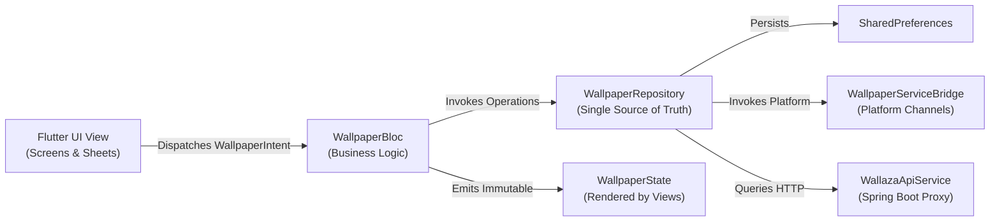

# Wallora & Wallaza — Architecture, Coding Structure & Linting Standards

> "Make every screen yours."

This document defines the unified architectural design, codebase folder layout, and automated static linting enforcement for the Wallora monorepo (Flutter Client + Java Spring Boot Backend).

---

## 1. Monorepo Architectural Overview

Wallora is structured as a co-located client-server repository where the Flutter mobile client and the Spring Boot cloud proxy coexist within a single source control tree:

```
live_wallpaper/
├── analysis_options.yaml            # Comprehensive Dart & Flutter linting rules
├── lib/                             # Wallora Flutter Client Core
│   ├── blocs/                       # State Management (BLoC / UDF Pattern)
│   ├── data/                        # Static Curated Fallback Library & Presets
│   ├── models/                      # Immutable Domain Models & Value Objects
│   ├── repositories/                # Storage, Platform Bridges & Service Repository
│   ├── screens/                     # Feature Screens & Modal Studio Sheets
│   ├── services/                    # REST HTTP Clients & Hardware Rendering Services
│   └── widgets/                     # Atomic Reusable Visual Components
├── test/                            # Comprehensive Automated Test Suites
│   ├── blocs/                       # BLoC Unit Tests (State Transitions & Intents)
│   ├── models/                      # Domain Model Serialization & Transformation Tests
│   ├── repositories/                # Repository & Persistence Integration Tests
│   └── widget_test.dart             # Golden & Interactive UI Widget Tests
├── backend/                         # Wallaza Cloud Proxy & Client SDK (Java 21 / Spring Boot)
│   ├── checkstyle.xml               # Java Checkstyle Linting & Style Rules
│   ├── pom.xml                      # Maven Build, Checkstyle & Plugin Configurations
│   ├── Dockerfile                   # Multi-Stage Alpine Docker Containerization
│   ├── docker-compose.yml           # Local Orchestration & Service Provisioning
│   └── src/
│       ├── main/java/com/wallaza/   # Spring Boot Application, REST Controllers & SDK
│       └── test/java/com/wallaza/   # JUnit 5 & MockMvc Integration Test Suites
└── .github/workflows/ci.yml         # Continuous Integration & Verification Pipeline
```

---

## 2. Flutter Client Coding Structure (`lib/`)

### 2.1 Unidirectional Data Flow (UDF) & Layer Responsibilities



1. **`lib/blocs/` (Intent-Driven State Management)**:
   - **`WallpaperIntent`**: Immutable events representing user intentions or system lifecycle events. All intent classes extend `Equatable`.
   - **`WallpaperState`**: Completely immutable state snapshot. Exposes computed selectors (e.g., `sortedCloudWallpapers`, `rotationPoolShorts`) and uses `copyWith()` for atomic transitions.
   - **`WallpaperBloc`**: Pure business logic orchestrator. Maps incoming intents to asynchronous repository operations and emits updated state snapshots.

2. **`lib/models/` (Domain Entities & Value Objects)**:
   - All models implement `Equatable` for value equality and deterministic state emission.
   - Domain models are immutable (`@immutable` classes with `final` fields).
   - Colors are serialized via `Color.toARGB32()` and deserialized via `Color(int)`.
   - JSON transformations (`toJson()`, `fromJson()`) must be symmetrical and resilient against missing fields.

3. **`lib/repositories/` (Data & Platform Abstraction Layer)**:
   - `WallpaperRepository` acts as the single source of truth across the application.
   - Encapsulates `SharedPreferences`, local directory file caching, platform channel messaging (`WallpaperServiceBridge`), and cloud API calls (`WallazaApiService`).
   - Views and BLoCs never interact with low-level platform channels directly.

4. **`lib/services/` (External Communications & Hardware Bridges)**:
   - `WallazaApiService`: Resilient HTTP client communicating with the backend proxy. Implements exponential timeout handling and falls back to offline curated libraries upon network dropouts.
   - `WallpaperRendererService`: Off-screen canvas rendering engine for social exports and dynamic lock screen wallpapers.

5. **`lib/screens/` & `lib/widgets/` (Presentation Layer)**:
   - Feature screens (`DiscoverScreen`, `CategoriesScreen`, `FavoritesScreen`, `DownloadsScreen`).
   - Specialized modal studio sheets (`WallazaCloudDiscoverySheet`, `AuroraSynthesizerSheet`, `WeatherAtmosphereSheet`, `StandbyDockSheet`, `DataPortabilitySheet`).
   - Atomic widgets (`VideoPlayerItem`, `KineticQuoteOverlay`, `ShortsActionRail`).

---

## 3. Java Spring Boot Backend Coding Structure (`backend/`)

The backend functions as a high-throughput, low-latency API proxy and client SDK around the Wallaza wallpaper ecosystem:

```
backend/src/main/java/com/wallaza/
├── WallazaApplication.java          # Spring Boot Application Entry Point
├── config/                          # Configuration Beans (Caffeine Cache, OpenAPI, RestClient)
│   ├── CacheConfig.java
│   └── OpenApiConfig.java
├── controller/                      # REST Endpoints with OpenAPI Documentation
│   └── WallpaperController.java
├── service/                         # Service Layer with In-Memory Caching
│   └── WallpaperService.java
├── client/                          # Standalone Wallaza Java Client SDK
│   ├── WallazaClient.java           # Client Interface Contract
│   ├── impl/WallazaClientImpl.java  # RestClient Implementation with Status Handlers
│   ├── model/                       # Java 21 Records (Wallpaper, Queries, Pagination)
│   └── exception/                   # Typed Exception Hierarchy (RateLimit, Auth, NotFound)
└── exception/                       # Global Exception Handler & Unified Error Responses
    └── GlobalExceptionHandler.java
```

### Architectural Principles:
- **Java 21 Records**: Models and DTOs use immutable `record` constructs for concise, safe data contracts.
- **In-Memory Caching (Caffeine)**: Frequent wallpaper queries and category feeds are cached with 1-hour TTL and maximum size constraints.
- **Typed Error Envelope**: All API exceptions are translated into uniform `WallazaErrorResponse` structures with standard HTTP status codes.

---

## 4. Linting Rules & Automated Enforcement

### 4.1 Flutter / Dart (`analysis_options.yaml`)

The Flutter codebase adheres to strict static analysis rules enforced through `flutter analyze --fatal-infos --fatal-warnings`:

| Rule Category | Enforced Lint Rules |
| :--- | :--- |
| **Async & Error Prevention** | `unawaited_futures`, `use_build_context_synchronously`, `cancel_subscriptions`, `close_sinks`, `throw_in_finally`, `empty_catches`, `avoid_empty_else`, `unrelated_type_equality_checks` |
| **Clean Code & Style** | `avoid_print`, `prefer_is_empty`, `prefer_is_not_empty`, `prefer_iterable_whereType`, `prefer_spread_collections`, `unnecessary_to_list_in_spreads`, `prefer_adjacent_string_concatenation`, `unnecessary_late` |
| **Modern Dart** | `use_super_parameters`, `prefer_null_aware_operators`, `prefer_if_null_operators`, `prefer_initializing_formals`, `type_init_formals` |
| **Flutter Widget Best Practices** | `avoid_unnecessary_containers`, `sized_box_for_whitespace`, `sized_box_shrink_expand`, `use_key_in_widget_constructors` |
| **Naming Conventions** | `camel_case_types`, `camel_case_extensions`, `file_names`, `non_constant_identifier_names`, `library_names` |

#### Enforcement Command:
```bash
flutter analyze --fatal-infos --fatal-warnings
```

---

### 4.2 Java Spring Boot (`backend/checkstyle.xml`)

The Java backend enforces style standards via `maven-checkstyle-plugin` configured with error-level severity during the build lifecycle:

| Rule Category | Checkstyle Module |
| :--- | :--- |
| **Package Conventions** | `PackageName` enforcing lowercase domain hierarchy (`com.wallaza.*`) |
| **Import Hygiene** | `AvoidStarImport` (no wildcard imports), `UnusedImports`, `RedundantImport`, `IllegalImport` |
| **Brace Discipline** | `NeedBraces` (mandatory curly braces for `if`, `else`, `for`, `while`), `LeftCurly`, `RightCurly` |
| **Naming Rules** | `TypeName`, `MemberName`, `ParameterName`, `LocalVariableName`, `ClassTypeParameterName` |
| **Code Correctness** | `EmptyStatement`, `EqualsHashCode`, `SimplifyBooleanExpression`, `SimplifyBooleanReturn`, `StringLiteralEquality` |

#### Enforcement Command:
```bash
cd backend
./mvnw checkstyle:check
```

---

## 5. UI & Widget Development Conventions

1. **Adaptive Switches**: Always use `activeThumbColor` and `activeTrackColor` on `Switch.adaptive` (never use the deprecated `activeColor`).
2. **Safe Modal Navigation**: In all dialogs, modal sheets, and callbacks:
   ```dart
   if (mounted && Navigator.of(context).canPop()) {
     Navigator.of(context).pop();
   }
   ```
3. **Material Ancestors for Ink Well**: In modal bottom sheets containing `ListTile` or `InkWell` items, wrap with `Material(color: ..., child: ...)` instead of `Container(decoration: ...)` to prevent occlusion of touch ripples.
4. **Bounded Simulation Badges**: When rendering phone status bars, preview badges, or metadata pills, wrap text widgets in `Flexible` or `Expanded` with `TextOverflow.ellipsis` to prevent `RenderFlex` overflow errors.
5. **Zero Sleep Overhead (Android)**: Native `WallpaperService` and background auto-rotation tasks must never hold wake-locks or consume CPU/GPU cycles when the device screen is off.
6. **Bandwidth Awareness**: Background downloads and cloud streaming must observe the user's Wi-Fi only preferences.

---

## 6. Verification & CI Workflow Checklist

Before any commit or pull request is merged to `main`, the following commands must execute cleanly:

```bash
# 1. Flutter Client Static Analysis (Zero Warnings / Zero Errors)
flutter analyze --fatal-infos --fatal-warnings

# 2. Flutter Full Test Suite (Unit + BLoC + Widget Tests)
flutter test --reporter=expanded

# 3. Backend Checkstyle Linting (Zero Violations)
cd backend && ./mvnw checkstyle:check

# 4. Backend Unit & Integration Tests (15+ Tests)
cd backend && ./mvnw clean test

# 5. Full CI Pipeline Emulation (Flutter + Backend + Docker Health)
./backend/mvnw package -DskipTests
```
