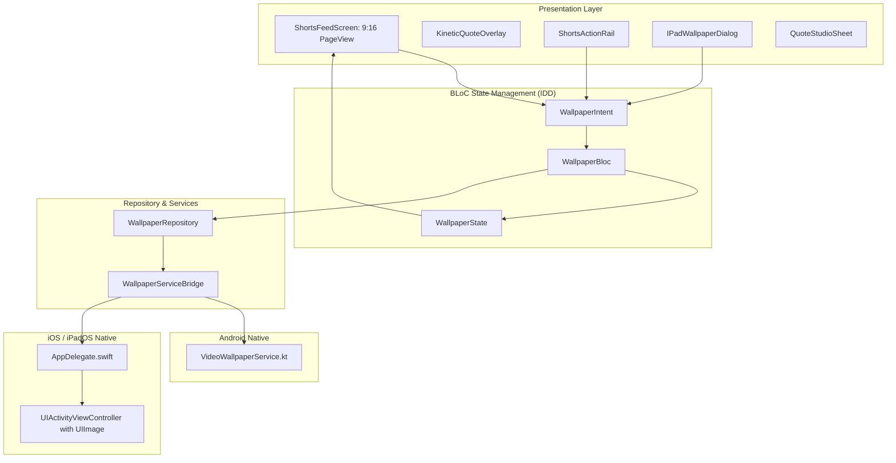

# Wallora ⚡
### *Make every screen yours.*

[](https://flutter.dev)
[](https://dart.dev)
[](https://bloclibrary.dev)
[]()
[-success)]()

**Wallora** is a flagship mobile wallpaper discovery platform combining **ultra-high-resolution static wallpapers**, **cinematic looping live video wallpapers**, and **kinetic typography studio** in a unified, high-performance experience. Built around the ethos **"Make every screen yours."**

---

## 📱 Features

- **Multi-Genre Live Wallpaper Feed**:
  - Full-screen 9:16 vertical swiping feed (*PageView* with *video_player*).
  - High-impact genres: Anime & Gaming (*Hajime no Ippo: Makunouchi Creed*), Nature & Scenery, Cyberpunk & Tech, Cars & Speed, Minimal & AMOLED, Fitness & Grind, Motivation & Mindset.
  - Autoplay visible video only, muted by default for battery savings.
- **Intent-Driven Architecture (IDD)**:
  - Strict Unidirectional Data Flow using `flutter_bloc` (`WallpaperIntent` -> `WallpaperBloc` -> `WallpaperState`).
  - Zero side-effects in views.
- **Android Native Live Wallpaper Engine**:
  - Custom `VideoWallpaperService.kt` (`android.service.wallpaper.WallpaperService`).
  - Zero battery drain when phone sleeps or an app is active (`onVisibilityChanged` pauses decoding immediately).
  - SurfaceHolder validation (`surface.isValid`) & automated asset recovery from bundle if files are cleaned.
  - Broadcast-driven instant switching between wallpapers without re-opening system chooser dialogs.
- **iPadOS & iOS Native Support**:
  - Custom `IPadWallpaperDialog` with 3-step native guidance.
  - High-resolution frame extraction via Swift `AVAssetImageGenerator`.
  - Native `UIActivityViewController` passing `UIImage` to directly unlock Apple's native **"Use as Wallpaper"** action.
  - PhotoKit `.addOnly` permission to save wallpaper images and video loops to Photos.
  - Adaptive layout with centered stage constraint on iPad screens (`shortestSide >= 600`).
- **Quote Customization Studio**:
  - Interactive modal to toggle between pure video and kinetic typography.
  - Select preset alternative quotes or write custom personal affirmations.
  - Preferences saved locally via `SharedPreferences`.

---

## 🛠️ Tech Stack & Architecture



---

## 🚀 Running the Project

### Prerequisites
- Flutter SDK 3.x
- Android SDK 26+ (for Android Live Wallpaper)
- Xcode 15+ & CocoaPods (for iOS/iPadOS)

### Install Dependencies
```bash
flutter pub get
cd ios && pod install && cd ..
```

### Run Tests & Analysis
```bash
flutter analyze
flutter test
```

### Build Releases
```bash
# Android Debug APK
flutter build apk --debug

# iOS Device Build
flutter build ios --no-codesign
```

---

## 📄 Documentation
- [SPEC.md](file:///Users/zml-mac-ranveerg-01/flutterProject/live_wallpaper/SPEC.md): Full technical specification & architecture.
- [PRODUCT_STRATEGY_AND_ROADMAP.md](file:///Users/zml-mac-ranveerg-01/flutterProject/live_wallpaper/PRODUCT_STRATEGY_AND_ROADMAP.md): 25-section Product Strategy, Architecture & Roadmap.
