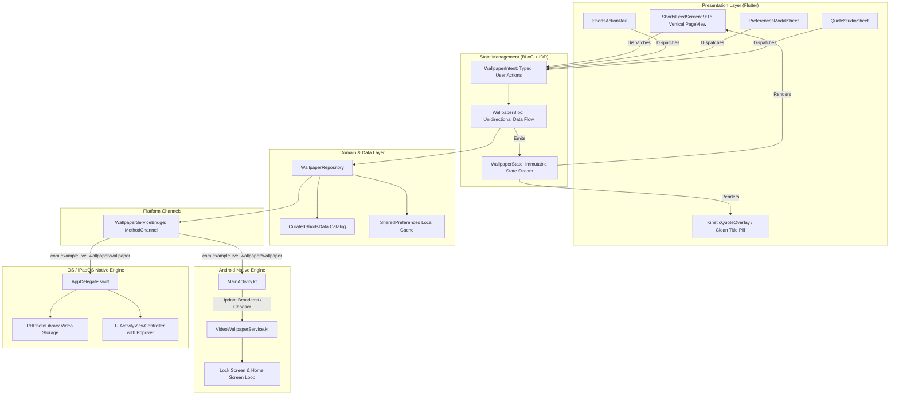

# Project Specification: Live Wallpaper Mobile Application

**Version**: 1.0.0  
**Status**: Implemented & Production-Ready  
**Architecture**: Intent-Driven Development (IDD) with Flutter BLoC  
**Platforms**: Android (API 26+), iOS / iPadOS (iOS 15.0+)  
**Repository**: [https://github.com/RanveerSingh1997/live_wallpaper](https://github.com/RanveerSingh1997/live_wallpaper)  

---

## 1. Executive Summary & Product Vision

### 1.1 Overview
The **Live Wallpaper** application is a high-performance cross-platform mobile product built with Flutter, designed to deliver looping vertical video wallpapers directly to users' **Lock Screens** and **Home Screens**. 

The application balances two complementary user needs:
1. **Dynamic Aesthetic Wallpaper Catalog**: Providing full-spectrum live wallpapers across diverse genres (Anime & Gaming, Nature & Scenery, Cyberpunk & Tech, Cars & Speed, Minimal & AMOLED, Fitness & Grind, and Motivation & Mindset).
2. **Preference-Driven Personalization & Text Control**: Enabling users to tailor their "For You" feed according to their chosen categories, while providing toggles between pure cinematic visual loops and kinetic motivational typography with customizable affirmations.

### 1.2 Core Value Propositions
- **Zero-Battery-Drain Engine**: Custom Android `WallpaperService` pauses decoding instantly when the display sleeps or when obscured by other apps (0% CPU/GPU overhead when screen is off).
- **Instant Live Switching**: Once configured as the active live wallpaper on Android, switching between videos in the app updates both screens instantaneously via broadcast intents without requiring re-entry into system chooser dialogs.
- **Dedicated iPad & Tablet Experience**: Adaptive responsive stage design with popover-anchored iPadOS Share Sheet enabling native "Use as Wallpaper" workflows.
- **Full Offline Capability**: Core video loops and local preferences are self-contained without mandatory cloud dependencies.

---

## 2. System Architecture



### 2.1 Architectural Pattern: Intent-Driven Development (IDD)
All state mutations follow strict Unidirectional Data Flow (UDF):
1. **User Action / UI Trigger**: The view only produces typed, immutable `WallpaperIntent` instances. The UI never mutates repository data or executes platform channels directly.
2. **Business Logic Orchestration**: `WallpaperBloc` handles intents sequentially, delegating side effects (disk I/O, cache, platform calls) to `WallpaperRepository`.
3. **State Emission**: New immutable `WallpaperState` instances are emitted through the BLoC stream, driving reactive UI rebuilds.

---

## 3. Functional Specifications

### 3.1 Vertical Live Wallpaper Feed
- **Interaction Model**: Full-screen 9:16 vertical swiping (`PageView.builder` with `Axis.vertical`).
- **Media Playback**: Seamless loop playback via `video_player`.
  - The active page video decodes and loops continuously.
  - Off-screen items are paused or disposed to conserve RAM and GPU cycles.
- **Gestures**:
  - *Single Tap*: Toggle pause/play with translucent playback HUD.
  - *Double Tap*: Add/remove from favorites with a burst heart animation.
  - *Vertical Drag*: Snap-scroll between wallpaper clips.

### 3.2 Multi-Category Catalog & Personalization
- **Supported Genres**:
  1. `Anime & Gaming`: Action, combat spirit (Flagship: *Hajime no Ippo: Makunouchi Creed*).
  2. `Nature & Scenery`: Mountains, auroras, moving water, tranquil environments.
  3. `Cyberpunk & Tech`: Neon rain, command-line aesthetics, terminal matrix grids.
  4. `Cars & Speed`: Supercars, nocturnal highway acceleration, drift aesthetics.
  5. `Minimal & AMOLED`: Deep black voids, liquid motion, minimalist geometric elegance.
  6. `Fitness & Grind`: Early morning workouts, bodybuilding, daily discipline.
  7. `Motivation & Mindset`: Stoic philosophy, timeless wisdom, resilience.
- **Personalized "For You" Feed Algorithm**:
  - User preferences are stored as a set of category strings.
  - When viewing "For You", items matching user preferences are sorted to the top of the feed (`_buildForYouList`), followed by remaining catalog items.
- **Preferences Modal Sheet (`PreferencesModalSheet`)**:
  - Genre multi-select chips with genre-specific accent colors and icons.
  - Quick action buttons ("All", "Clear").
  - Persistent master switch for text overlay visibility.

### 3.3 Text Overlay & Kinetic Typography
- **Pure Video vs. Typography**:
  - Wallpapers with `hasTextByDefault: false` render pure video loops.
  - `isTextOverlayVisible` state toggle allows users to hide/show quotes on any wallpaper at will.
  - When text is hidden, an unobtrusive title chip (`Icons.auto_awesome_rounded` + short title) is displayed at the bottom left.
- **Quote Customization Studio (`QuoteStudioSheet`)**:
  - Users can select from alternative preset quotes.
  - Users can input custom text affirmations or reminders.
  - Custom quotes are persisted per-short-id and override defaults.
  - "Reset to Default" button clears overrides.

### 3.4 Android Native Live Wallpaper Engine
- **Service**: `VideoWallpaperService.kt` (registered in `AndroidManifest.xml` under `android.permission.BIND_WALLPAPER`).
- **Rendering**: Hardware-accelerated `MediaPlayer` rendering to `SurfaceHolder`.
- **Scaling**: `MediaPlayer.VIDEO_SCALING_MODE_SCALE_TO_FIT_WITH_CROPPING` prevents distortion on diverse aspect ratios (18:9, 19.5:9, 20:9, 21:9).
- **Lifecycle & Resilience Optimization**:
  - `onVisibilityChanged(true)`: Restarts playback when lock screen or home screen is visible.
  - `onVisibilityChanged(false)`: Pauses decoder immediately when the phone sleeps or an app is active (0% background drain).
  - *Surface Validation*: Verifies `surface.isValid` prior to attaching `MediaPlayer`, preventing illegal state crashes.
  - *Automatic File Recovery*: If the active wallpaper video file was wiped by a storage cleaner, the engine automatically checks candidate files or extracts the bundled default asset from `flutter_assets`, ensuring the home screen never renders blank.
- **Instant Switch**:
  - Listens to internal broadcast `ACTION_UPDATE_WALLPAPER`.
  - When already active, changing wallpapers in the Flutter UI instantly switches the video stream without popping the system chooser dialog.

### 3.5 iPadOS / iOS Native Wallpaper Workflow
- **Layout Adaptation**: Responsive tablet constraint (`shortestSide >= 600`) keeps 9:16 vertical videos centered with ambient dark backdrop on iPad screens (4:3, 3:2).
- **High-Res Frame Extraction & Photos Export**: Swift extracts full-resolution 4K/Retina `UIImage` frames via `AVAssetImageGenerator` and saves both the image and video loop using PhotoKit `.addOnly` authorization.
- **Anchored Activity View Controller**: Invokes `UIActivityViewController` passing the `UIImage`, which enables the native iPadOS **"Use as Wallpaper"** action button, anchored to screen center to ensure zero-crash popovers.

---

## 4. Platform Channel Specifications

- **Channel Identifier**: `com.example.live_wallpaper/wallpaper`

### Methods

| Method | Arguments | Returns | Description |
| :--- | :--- | :--- | :--- |
| `setLiveWallpaper` | `videoPath: String`, `isMuted: Boolean` | `Map<String, Any>` | Sets the active wallpaper. On Android, updates service directly if active, otherwise launches `ACTION_CHANGE_LIVE_WALLPAPER`. On iOS, saves to Photos. |
| `isLiveWallpaperActive` | None | `Boolean` | Checks if `VideoWallpaperService` is the currently active device wallpaper (Android only; returns `false` on iOS). |
| `shareVideo` | `videoPath: String`, `title: String` | `Boolean` | Opens native Share Sheet. On iPad, anchors popover to prevent crash. |
| `openPhotos` | None | `Boolean` | Launches native iOS Photos app (`photos-redirect://`). |

### Status Return Schema (`setLiveWallpaper`)
```json
{
  "status": "updated_active | opened_chooser | saved_to_photos | unsupported_platform | error",
  "message": "Human readable status string",
  "error": "Optional error message if failed"
}
```

---

## 5. Data Models & Local Persistence

### 5.1 `MotivationalShort` (alias `LiveWallpaperItem`)
```dart
class MotivationalShort extends Equatable {
  final String id;
  final String title;
  final String quote;
  final String author;
  final String category;
  final String videoAssetPath;
  final Color accentColor;
  final List<String> alternativeQuotes;
  final String tags;
  final bool hasTextByDefault;
  final String mood;
}
```

### 5.2 Local Storage (`SharedPreferences`)

| Key | Type | Description |
| :--- | :--- | :--- |
| `favorite_short_ids` | `List<String>` | IDs of wallpapers marked as favorites |
| `custom_quote_<shortId>` | `String` | Custom quote override for a specific wallpaper |
| `active_wallpaper_id` | `String` | ID of the last short applied as device wallpaper |
| `user_preferred_categories` | `List<String>` | User's preferred categories for feed sorting |
| `is_text_overlay_enabled` | `bool` | Master switch state for text overlay visibility |

---

## 6. Non-Functional Requirements & Performance Benchmarks

1. **Battery Consumption**:
   - `0% CPU / GPU` usage when phone screen is turned off or locked with wallpaper obscured.
   - Low energy hardware-accelerated playback during active display.
2. **Frame Rate**:
   - Smooth 60 FPS vertical scrolling across feed pages.
   - Smooth 60 FPS live wallpaper video loop.
3. **Memory Footprint**:
   - Only active video controller initialized; adjacent controllers pre-buffered; distant controllers disposed.
   - Target heap memory under 90MB on standard Android and iOS devices.
4. **App Binary Footprint**:
   - Optimized release artifacts under 35MB including bundled flagship video loops.
5. **Security & Permissions**:
   - `BIND_WALLPAPER`: Android system service permission.
   - `NSPhotoLibraryAddUsageDescription`: iOS permission for saving wallpaper loops.

---

## 7. Testing & Quality Assurance

### 7.1 Automated Intent-Driven Tests
- **Test File**: `test/blocs/wallpaper_bloc_test.dart`
- **Coverage**:
  - `LoadFeedIntent`: Catalog loading, favorite IDs restoration, custom quote mapping.
  - `ChangeActiveShortIntent`: Bounds checking and page index tracking.
  - `ToggleFeedMuteIntent`: Feed audio mute/unmute state toggling.
  - `FilterByCategoryIntent`: Exact category filtering vs "All".
  - `UpdateUserPreferencesIntent`: Dynamic For You reordering and preference persistence.
  - `ToggleTextOverlayVisibilityIntent`: Text overlay state inversion.
  - `ToggleFavoriteIntent`: Addition and removal from favorites set.
  - `UpdateCustomQuoteIntent` & `ResetCustomQuoteIntent`: Overrides and default restorations.

### 7.2 Widget Tests
- **Test File**: `test/widget_test.dart`
- **Coverage**:
  - `KineticQuoteOverlay`: Typography rendering, author line, accent color badging, custom quote tags.
  - `ShortsActionRail`: Tap callbacks for Apply, Customize, Mute, Favorite, and Share.

---

## 8. Directory Structure

```
live_wallpaper/
├── android/
│   └── app/src/main/
│       ├── AndroidManifest.xml              # Permissions & Wallpaper service registration
│       ├── res/xml/wallpaper.xml            # Android wallpaper metadata & thumbnail
│       └── kotlin/com/example/live_wallpaper/
│           ├── MainActivity.kt              # MethodChannel handler
│           └── VideoWallpaperService.kt     # Native Android live wallpaper engine
├── ios/
│   ├── Podfile                              # Minimum iOS target 15.0
│   └── Runner/
│       ├── Info.plist                       # Photo Library add permissions
│       └── AppDelegate.swift                # iOS Photos export & iPad popover share sheet
├── assets/
│   ├── icon/app_icon.png                    # Master 1024x1024 icon
│   └── videos/                              # Bundled looping MP4 assets
├── lib/
│   ├── blocs/
│   │   ├── wallpaper_bloc.dart              # IDD BLoC state coordinator
│   │   ├── wallpaper_intent.dart            # Typed user intents
│   │   └── wallpaper_state.dart             # Immutable UI state
│   ├── data/
│   │   └── curated_shorts_data.dart         # Multi-genre catalog definitions
│   ├── models/
│   │   └── motivational_short.dart          # LiveWallpaperItem domain model
│   ├── repositories/
│   │   └── wallpaper_repository.dart        # Persistence & asset bridge abstraction
│   ├── screens/
│   │   ├── preferences_modal_sheet.dart     # Personalization modal sheet
│   │   ├── quote_studio_sheet.dart          # Quote customization sheet
│   │   └── shorts_feed_screen.dart          # Vertical feed & top controls
│   ├── services/
│   │   └── wallpaper_service_bridge.dart    # MethodChannel wrapper
│   └── widgets/
│       ├── kinetic_quote_overlay.dart       # Typography overlay
│       ├── shorts_action_rail.dart          # Vertical action buttons
│       └── video_player_item.dart           # Seamless video loop player
└── test/
    ├── blocs/wallpaper_bloc_test.dart       # Unit & BLoC tests
    └── widget_test.dart                     # UI component widget tests
```

---

## 9. Future Roadmap

1. **Cloud CDN Streaming Catalog**: Dynamic loading of expanded 4K live wallpapers via cloud streaming to reduce initial app binary size.
2. **User Video Import**: Allowing users to import their own MP4/MOV videos from camera roll and apply custom kinetic typography.
3. **Audio-Reactive & Gyroscope Parallax**: Optional subtle parallax shift reacting to device accelerometer.
4. **Lock Screen Widgets (iOS 16+ / Android 14+)**: Complementary motivational quote lock screen widgets synced with the active wallpaper.
